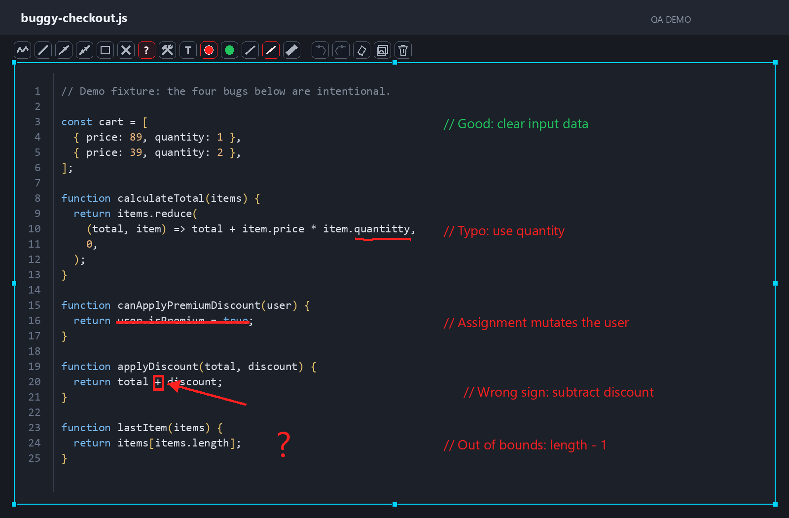
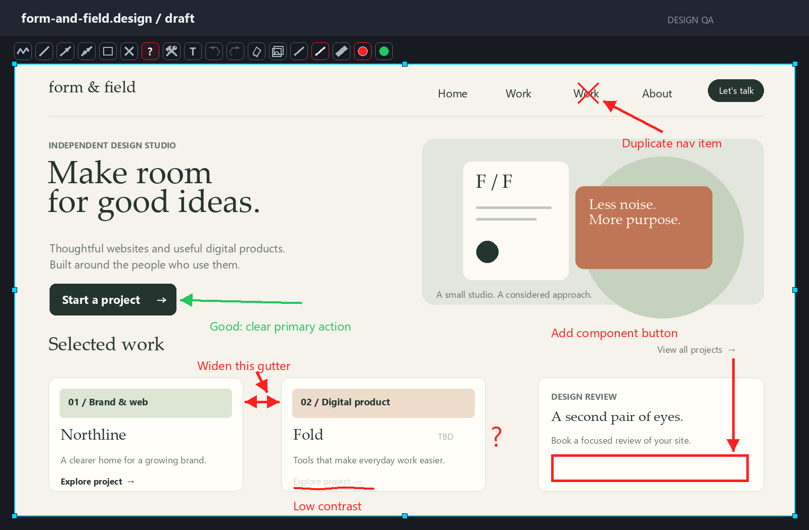

# Infershot

Infershot is a lightweight Windows screenshot tool for fast capture and visual QA.
It runs in the background, saves numbered screenshots, copies them to the clipboard,
and adds colored annotations before saving a selected region.





## Features

- Rectangle capture across the Windows virtual desktop
- Full-monitor capture for the monitor under the cursor
- Movable and resizable selection rectangle
- Selection-anchored buttons for freehand, line, arrows, rectangle, stamps, text, colors, stroke widths, Undo/Redo, eraser, Screenshot manager, and Clear folder
- DPI-matched text preview with a live keyboard layout and Caps Lock indicator
- Drag or two-click line, arrow, double-arrow, and rectangle annotations
- Per-annotation stroke width and scalable repair stamps
- Screenshot manager for saved files, individual copy, PNG ZIP archives, and full-resolution Copy sheet
- Automatic numbered filenames
- Optional clipboard copy
- Configurable capture, annotation, save, and cancel hotkeys

## Requirements

- Windows 10 or Windows 11
- Python 3.9 or newer
- [Pillow](https://pypi.org/project/pillow/)
- Tkinter, normally included with the standard Windows Python installer

The global PrintScreen hook and clipboard integration use Windows APIs, so the
application is not cross-platform.

## Installation

```powershell
git clone https://github.com/inferixon/infertools-infershot.git
cd infertools-infershot
python -m pip install -r requirements.txt
```

Review `config.json`, then launch:

```powershell
.\run-infershot.bat
```

Stop the background process with:

```powershell
.\stop-infershot.ps1
```

## Updating An Installed Copy

Run from the updated source checkout:

```powershell
python -m unittest discover -s tests
python update-installation.py --target C:\Infertools\Infershot
```

The updater replaces application files, backs up changed files under the target's
`.updates/` folder, and recursively adds missing configuration keys. Existing
settings, custom keys, and color lists are preserved. Restart the installed copy
after updating: run its `stop-infershot.ps1`, then `run-infershot.bat`.

## Default hotkeys

| Action | Hotkey |
| --- | --- |
| Select a rectangle | `PrintScreen` |
| Capture the monitor under the cursor | `Ctrl+PrintScreen` |
| Start a line | `Ctrl+LeftMouse` |
| Finish the active line | `LeftMouse` |
| Start an arrow | `Ctrl+RightMouse` |
| Finish the active arrow | `RightMouse` |
| Undo the last annotation action | `Ctrl+Z` |
| Redo an annotation action | `Ctrl+Shift+Z` or `Ctrl+Y` |
| Open Screenshot manager | `Shift+PrintScreen` |
| Save the selected capture | `Enter` |
| Cancel the pending annotation or capture | `Escape` |

For a rectangle capture, drag with the left mouse button. Before adding an
annotation, the selection can be moved from its interior or resized with its handles.
The second arrow click marks the arrow tip. Completed annotations are included in
both the saved image and the clipboard image. If a line or arrow has been started
but not finished, `Escape` removes only that pending annotation. With no pending
annotation or drawing mode, `Escape` cancels the capture. When a drawing tool is
active, the first `Escape` cancels its pending edit and restores selection mode;
the next `Escape` closes the capture.

After selecting a rectangle, use the floating buttons above its left edge. The
button group has no panel; each rounded button uses a faint border, a translucent
fill, wider spacing, and a subtle white hover glow. The tools appear in this order:

- Freehand – hold and drag the left mouse button.
- Line – drag, or click the start and end points.
- Arrow – drag, or click the start point and then the arrow tip.
- Double arrow – drag or use two clicks to add arrowheads at both ends.
- Rectangle – drag or click opposite corners to frame an area.
- Cross – click once for the configured size, or hold and drag to resize X.
- Question mark – click once for the configured size, or hold and drag to resize `?`.
- Fix this – place a repair-tools stamp; click for the default size or drag to resize.
- Text – click inside the selection for the configured font size, or hold and
  drag a text frame to set its size. Typing expands the transparent, border-only
  frame as needed. A compact status shows the active `EN`, `NO`, or `UA` layout
  and Caps Lock state. `Enter` starts a new line, `Ctrl+Enter` commits the text,
  and `Escape` cancels the active text editor.
- Color circles – select the color for subsequent annotations. They follow Text
  in the order listed in `colors`; the count matches that list.
- Stroke widths – select a configured width for subsequent shapes and freehand
  marks. Existing annotations and text sizes stay unchanged.
- Undo/Redo – after a wider gap, step through annotation actions, including clearing with Eraser.
- Eraser – clear every completed or pending annotation without closing or changing
  the capture selection.
- Screenshot manager – view saved captures; closing the manager resumes the unfinished
  selection with its annotations intact.
- Clear folder – move screenshot image files to the Infershot recovery folder
  immediately. `ScreenShot-*.*` and `ScreenSheet-*.*` files are cleared.

`Ctrl+Z` removes the latest completed annotation. If Eraser cleared the canvas,
`Ctrl+Z` restores the annotations it removed. The undo buffer keeps the latest
`undo_limit` states (20 by default).

Redo uses `Ctrl+Shift+Z` or `Ctrl+Y`; a new drawing action clears the redo branch.
The toolbar stays anchored to the selection and cannot be dragged independently.

## Screenshot manager – 1.5

Open the manager with `Shift+PrintScreen` or its selection-toolbar icon. It never
opens automatically after capture. The manager reads the most recent
`gallery.limit` images from `save_path`, including files saved before restart.
The manager and Clear folder icons are disabled when that folder has no images.
The borderless window closes with `Esc` or the corner close icon shown on hover.
Drag its empty top strip to move the manager.
Its square thumbnails have hover
icons for Copy and Remove; click a thumbnail to include/exclude it. The three
adjacent action icons are Copy sheet, Save ZIP archive, and Clear screenshot folder, with
hover tooltips and keyboard focus. The window sizes to its content and wraps
thumbnails as needed; it has no scrollbars or text action buttons. PNG archives
export selected immutable snapshots with unique filenames. Sheets preserve each
image's native resolution and order, with 24 px gutters.
Copy sheet also saves `ScreenSheet-001`, `ScreenSheet-002`, etc. in `save_path`,
using the configured image format and quality, with separate screenshot numbering.
Use the two filter icons to show screenshots and sheets independently. Both
start enabled. The app saves each switch in `config.json`. Copy sheet and ZIP
export use selected images that match the filters.
The thumbnail close icon immediately moves that image file to the Infershot
recovery folder; it stays deleted when the manager is reopened. A new capture
hides the manager before grabbing the desktop. The separate Clear folder toolbar
action, also available in the manager, moves all direct `ScreenShot-*.*` and
`ScreenSheet-*.*` files to a unique batch under
`%LOCALAPPDATA%\Infershot\Trash`; `restore.json` records their original folder.
Move those files back to restore them. It does not recurse into subfolders.
Thumbnails use 336 px tiles (3× the original size), with page arrows when needed
instead of scrollbars. The manager opens centered on the current monitor, or
beside the selection when opened from its toolbar and space permits.
Legacy `gallery.show_after_capture` and `hotkeys.gallery` settings are ignored.

Click the active toolbar icon again to return to normal selection move mode.
Resize handles always remain available, including after annotations are added.

## Configuration

`config.json` is reloaded on every `PrintScreen` invocation, so edits apply without restarting Infershot.

```json
{
  "save_path": "C:\\SCREENSHOTS",
  "format": "jpg",
  "quality": 95,
  "filename_mask": "ScreenShot-{nnn}",
  "copy_to_clipboard": true,
  "undo_limit": 20,
  "stroke": {"width": 5, "choices": [3, 5, 9]},
  "gallery": {"limit": 20, "show_screenshots": true, "show_sheets": true},
  "colors": ["#ff2020", "#22c55e"],
  "text": {
    "font_family": "Palatino Linotype",
    "font_size": 24
  },
  "cross": {
    "size": 48
  },
  "question": {
    "size": 48
  },
  "repair": {"size": 48},
  "hotkeys": {
    "rectangle": "PrintScreen",
    "fullscreen": "Ctrl+PrintScreen",
    "line_start": "Ctrl+LeftMouse",
    "line_finish": "LeftMouse",
    "arrow_start": "Ctrl+RightMouse",
    "arrow_finish": "RightMouse",
    "save": "Enter",
    "undo": "Ctrl+Z",
    "redo": "Ctrl+Shift+Z",
    "redo_alternative": "Ctrl+Y",
    "screenshot_manager": "Shift+PrintScreen",
    "cancel": "Escape"
  }
}
```

Supported selector combinations use `Ctrl`, `Shift`, or `Alt` with
`LeftMouse`, `RightMouse`, `Enter`, `Escape`, or a single keyboard character.
Capture shortcuts currently use PrintScreen with optional modifier keys.

If a config field is missing, the built-in default from `infershot.py` is used.
The default annotation font is Palatino Linotype at 24 points. Font size is
clamped to 8–96 points and DPI-matched in the saved image. Drag-sized text also
uses this range without changing the configured default. A short cross click
uses the configured 48 px default; hold and drag for a live size from 16–256 px.
The question mark has its own `question.size` default and uses the same drag
gesture. `colors` accepts `#RRGGBB` values in display order; an empty list hides
the color buttons and keeps the built-in red fallback. Each completed annotation
keeps its chosen color when another color is selected or an action is undone.
Stroke widths accept integer values from 1–24 px, with 3/5/9 px shown by default.
`repair.size` uses the same 16–256 px sizing range as the other drag-sized stamps.

## Runtime state

One instance runs per interactive Windows session. Logs and PID files live under
`%LOCALAPPDATA%\Infershot\sessions\<session-id>`, so different users and sessions
do not share mutable runtime files. `stop-infershot.ps1` stops only the exact
installed script in the caller's session. Configuration stays beside the script;
existing screenshot locations and preferences are retained.

## License

Infershot is released under the [MIT License](LICENSE). You may use, modify,
distribute, sublicense, or sell copies of the software while preserving the
license and copyright notice.
